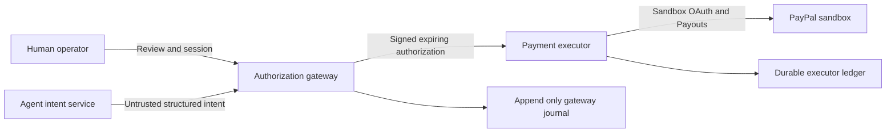

# Architecture

## Trust boundaries

Implemented controls: (1) strict schema, cents arithmetic and fixed policies; (2) Ed25519 grants binding immutable intent, request, environment, policy version and expiry; (3) three child processes with explicit environment allowlists; (4) human sessions and state transitions; (5) Payouts OAuth/create/status adapter; (6) responsive workspace; (7) negative-path and restart tests, desktop/mobile browser review.

`scripts/start.mjs` is a trusted launcher. It reads only this repository's .env, generates a gateway signing key and service tokens, then launches three loopback HTTP processes. The agent receives no PayPal secrets, operator PIN, private signing key, executor token, or journal-directory configuration. The gateway receives the private signing key and operator PIN, but no PayPal secrets. The executor receives only the public verification key, private service token, sandbox credentials, fixed policy and its ledger directory. Internal ports are assigned by the OS. Only the gateway exposes the web UI on 127.0.0.1:3000.

The agent turns text into an intent using a labeled demo parser or local Ollama. The Ollama path rejects tested explicit ambiguity before inference and rejects model alterations of explicit amounts, currency, email or supported invoice references. This guard is not a general natural-language correctness guarantee. No model-generated scripts, URLs, tools, or authorization decisions are executed. The gateway treats all provider output as untrusted, validates an exact schema, makes policy decisions, and stores events. The browser never receives signing material or executor credentials. Intent submission is distinct from operator-only approval and execution.

Every executor call needs a private service token AND a valid Ed25519 signature. Grants include audience, sandbox environment, policy version, unique request ID, issuance/expiry, intent digest and human approval evidence when required. The executor independently revalidates schema and fixed rules, checks the signed human-approval assertion, and durably reserves both grant/request and recipient/invoice before network I/O. Replays and concurrent duplicates fail closed. Human approval signs only stored values; request-body edits cannot alter them.

State: pending_approval / allowed → approved when required → executing → submitted or simulated. Human rejection → rejected; policy denial → denied. Expiration blocks execution. A failed/ambiguous attempt stays reserved; there is no automatic resubmission. Status refresh reads the known batch. PayPal batch SUCCESS and individual item SUCCESS are distinct; the UI shows both and never equates API acceptance with settlement.

Hash-chained JSONL events reconstruct requests across restart. Append uses fsync and fails before side effects when storage is unavailable. Executor reservations survive restart. Torn/corrupt journals fail startup rather than discarding evidence. One exclusive launcher lock per data directory prevents independent instances from racing the same files. No reset/delete API. Export is read-only.

## Limits

Process/environment and application capability separation protects against malicious prompts and unauthorized HTTP calls. It is not an OS sandbox against arbitrary code execution under the same user: all processes share a UID and the host filesystem. Protecting against a fully compromised process requires separate OS users/containers, network restrictions and independently mounted secrets. The signing gateway and launcher are trusted. Local file-owner modification, full journal rewrite/truncation, stolen operator sessions and host compromise are outside the promised boundary. Hash chaining detects internal edits against the stored chain, not a malicious administrator rewriting the entire chain. No multi-tenant auth, cloud exposure or production payment mode.

## Official integration references

- [Payouts integration](https://developer.paypal.com/api/payouts)
- [Create batch payout](https://developer.paypal.com/api/payments.payouts-batch/v1/payouts-post/)
- [OAuth authentication](https://developer.paypal.com/api/rest/authentication/)
- [Duplicate and idempotency behavior](https://developer.paypal.com/docs/payouts/standard/integrate-api/customize/)
- [Local AI chat API](https://docs.ollama.com/api/chat)

The adapter hardcodes https://api-m.sandbox.paypal.com. There is no configurable PayPal base URL or live mode. It uses stable sender_batch_id / sender_item_id and PayPal-Request-Id, and manually polls only known batch identifiers.
