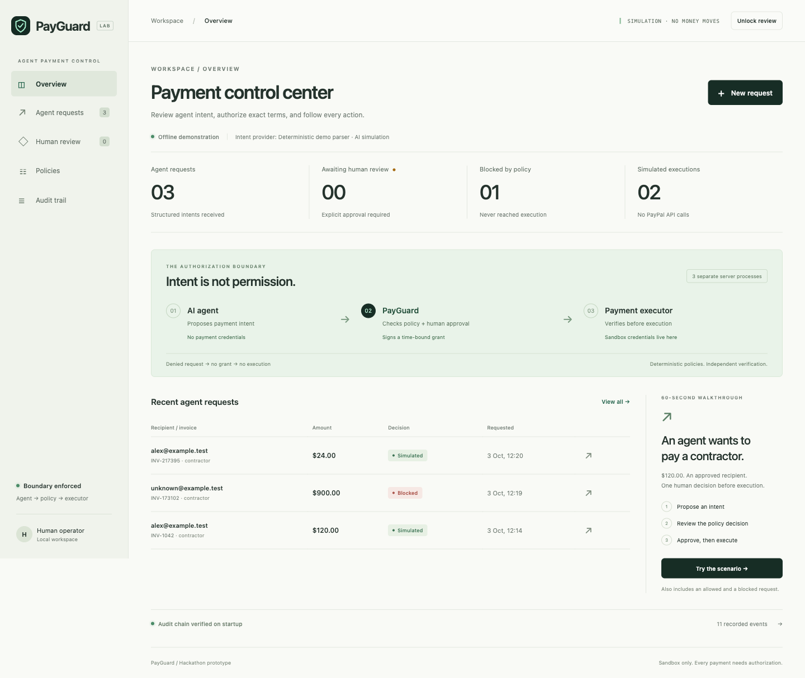
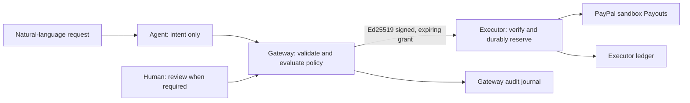

# PayGuard

**AI proposes. Policy authorizes. A separate executor pays.**

PayGuard is a local, sandbox-only payment authorization prototype for business agents. Natural-language requests become structured intents; deterministic rules decide whether to allow, require human review, or deny. The agent receives no payment credentials or signing key.

On 4 October 2026, two USD 0.01 PayPal sandbox payouts settled through the full flow and were independently reconciled through the API. The second used real local Ollama extraction. Nine AI/input/policy scenarios passed. See [current verification status](STATUS.md).



*Screenshots show the offline demonstration with synthetic identities. They are UI examples, not proof of PayPal settlement or model inference.*

## Run the offline demo

Requires **Node.js 20.9+ and npm**. There are no npm dependencies to install.

```sh
npm start
```

On a fresh checkout, open **http://127.0.0.1:3000**. The default operator passphrase is **payguard-demo**, usable only for simulation. All services bind to loopback. Stop with Ctrl+C.

If you already configured sandbox credentials, explicitly select the offline demo:

```sh
PAYMENT_PROVIDER=demo AI_PROVIDER=demo OPERATOR_PIN=payguard-demo npm start
```

Stop any existing PayGuard launcher before starting another. Preserve its journals.

1. Choose **New request → $120 · Human review**. Inspect the intent and rule checks.
2. Authenticate, approve the stored terms, then choose **Simulate authorized payment**. Approval and execution are separate actions.
3. Try **$900 · Blocked**. The denied request cannot receive authorization or reach the executor.
4. Try **$24 · Policy allowed**, then inspect the receipt and audit trail.

Samples generate fresh invoice references. Reusing an executed recipient/invoice is blocked; a request expires five minutes after proposal.

## How it works



The gateway enforces USD, a USD 500 ceiling, human review above USD 50, a fixed recipient allowlist, contractor/software categories and recipient/invoice deduplication. The executor independently verifies the signature, immutable intent, expiry, policy and required review before reserving execution durably and calling PayPal. Denial cannot be overridden by human review. No automatic payment retry occurs after an uncertain outcome.

This is application/process separation on a trusted local host. It is not OS isolation against hostile code running as the same user. Read the [architecture](ARCHITECTURE.md) and [threat model](THREAT_MODEL.md).

## Enable real local AI

Install [Ollama from its official source](https://ollama.com/download) and download the verified small model:

```sh
ollama pull qwen2.5:1.5b
```

Run the local server with cloud disabled. Stop any existing Ollama server first if starting it this way:

```sh
OLLAMA_NO_CLOUD=1 OLLAMA_HOST=127.0.0.1:11434 ollama serve
```

Create `.env` only if it does not already exist:

```sh
cp -n .env.example .env
chmod 600 .env
```

Set these locally:

```dotenv
AI_PROVIDER=ollama
OLLAMA_MODEL=qwen2.5:1.5b
```

Restart PayGuard. The model runs independently of payment mode, so real AI can be demonstrated with offline payments. Ollama 0.35.1 and qwen2.5:1.5b were verified on an Apple Silicon Mac with 16 GB RAM. Model weights and runtime are downloaded separately and are not distributed with this repository.

Try “Pay alex@example.test $120 for invoice INV-1042 for contractor development work” in the offline recipient configuration. Strict six-field validation and explicit-term checks reject tested ambiguity and model alterations. The model has no tools or authorization role; its availability/validation failures never silently fall back to simulation. These checks do not establish correctness for every natural-language sentence.

## Enable PayPal sandbox

1. Open [Developer Dashboard](https://developer.paypal.com/dashboard/) → **Apps & Credentials → Sandbox**. Select a REST app associated with a **Business sandbox sender**, with Payouts available.
2. Open **Testing Tools → Sandbox Accounts**. Confirm that the recipient is a separate **Personal sandbox account**. Verify sufficient sender USD sandbox balance, including fees, before any payout.
3. Put only these sandbox values in the ignored local `.env`. Do not use account-login or NVP/SOAP passwords as the REST secret.

```dotenv
PAYMENT_PROVIDER=paypal-sandbox
PAYPAL_CLIENT_ID=your-sandbox-rest-client-id
PAYPAL_CLIENT_SECRET=your-sandbox-rest-client-secret
SANDBOX_RECIPIENT_EMAIL=your-personal-sandbox-recipient-email
OPERATOR_PIN=your-private-passphrase-of-at-least-12-characters
```

4. Run `npm run verify:paypal` first. It requests OAuth only, never a payment. Scope presence does not prove funding or settlement.
5. Restart PayGuard and confirm **PAYPAL SANDBOX**. Propose a USD 0.01 contractor payment with a fresh invoice. Review the structured terms and explicitly execute through PayGuard. Human threshold review is not required for USD 0.01; authenticated operator execution remains required.
6. Refresh the recorded receipt. Run `npm run verify:payout -- <recorded-request-uuid>` for independent, read-only reconciliation against both journals and PayPal. Exit 0 requires batch and item `SUCCESS`; exit 2 means matched terms without full settlement. Never resend an uncertain payment.

The API origin is hardcoded to **https://api-m.sandbox.paypal.com**, redirects are refused, and no production mode exists. OAuth tokens stay in memory. Local evidence omits credentials, tokens, recipient email and raw responses. Journals still contain payment terms and belong only on the local machine.

An interrupted attempt remains reserved. Recover a recorded receipt in PayGuard or manually reconcile its sender-batch reference if no batch response was saved; changing an invoice to retry an uncertain payment defeats the safety design.

## Verify and package

```sh
npm test
npm run check
```

Tests exercise actual three-process HTTP/restart behavior and local provider fixtures: policy, schema, tampering, expiry, missing review, replay, concurrency, durable reservations, uncertain outcomes, environment isolation and HTTP protections. They do not create external payments.

With the sandbox/Ollama stack configured, `npm run verify:ai` runs nine live AI/input/policy cases and checks review/denied execution returns HTTP 403. It never approves or executes an allowed payment. The independent AI choice also supports offline use without PayPal credentials; the verification CLI intentionally targets the configured sandbox stack.

`npm run package:release` audits the exact allowlist in [RELEASE_FILES.txt](RELEASE_FILES.txt) and builds a local source archive under ignored `data/release/`. It excludes credentials, evidence, model files, internal submission notes and Git history. A package is not authorization to publish.

## Demo and assets

- [150-second recording script](DEMO_SCRIPT.md)
- [Screenshot provenance and reuse notes](docs/assets/README.md)
- [Product scope](PRODUCT.md)

## Release status

Copyright 2026 Arvydas Kostinas. The project source, documentation and original UI assets are licensed under [Apache-2.0](LICENSE); see [NOTICE](NOTICE) for attribution. Separately installed Ollama runtimes and model weights are not distributed in this package and retain their own licenses. No public repository, hosted deployment, competition submission or production integration has been created.
