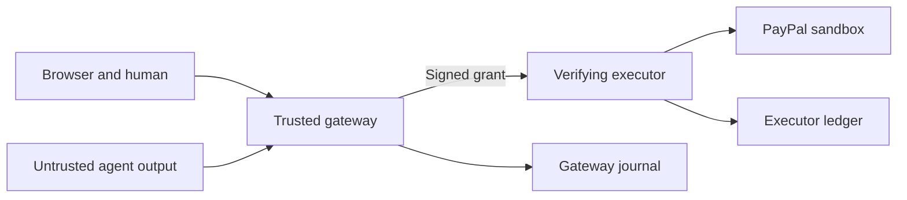

# PayGuard threat model

## Executive summary

Model output has no execution authority. Exact intent validation, deterministic policy, authenticated review and a separately verifying executor enforce payment authorization. Residual risks include trusted-host compromise, stolen human sessions, renamed duplicate invoices and ambiguous provider results. This is a local prototype review, not production certification.

## Scope and assumptions

The user established a local, single-operator sandbox prototype with new code and synthetic data. In scope: `src/`, `scripts/start.mjs`, `public/`, HTTP routes and journals. Public hosting, production money, arbitrary executable agents, account enrollment and multi-tenancy are excluded. The host, launcher, gateway and fixed policies are trusted. Processes share a UID and filesystem: child-environment separation is not an OS sandbox. No deployment/CI pipeline exists; test fixtures are development evidence, not real-provider evidence.

Future questions: hosting/OS identities, operator identity provider, retention/checkpoint requirements and additional sandbox permissions. These do not block the established local scope.

## System model

### Primary components

- `scripts/start.mjs`: validated modes, exclusive data-directory lock, ephemeral keys/tokens and child environment allowlists.
- `src/agent.mjs`: demo extraction or optional local Ollama; no PayPal, operator, signing or executor credentials passed in its environment.
- `src/gateway.mjs`: intent validation, policy, durable state, authenticated review and grants from current authorized state.
- `src/executor.mjs`: caller authentication, independent grant/rule verification and durable reservation before provider I/O.
- `src/paypal.mjs`: demo provider or fixed-origin sandbox OAuth/Payouts/status with redirect refusal and redacted errors.
- `src/journal.mjs`: append/fsync, hash chain, startup verification and replay reconstruction.

### Data flows and trust boundaries

- Browser → gateway: untrusted prompt/intent over loopback HTTP. Host/origin/cross-site checks; 16 KB JSON body cap; proposal/login limits. Human actions/export need HttpOnly SameSite=Strict sessions (`gateway.mjs`, `http.mjs`). Local HTTP cookies lack Secure; HTTPS/public hosting is outside scope.
- Gateway → agent → gateway: bearer-authenticated loopback prompt/intent; provider output revalidated (`agent.mjs`, `rpc`, `validateIntent`). No generated code/tool/URL is executed.
- Human → gateway: private passphrase establishes a 30-minute session. Sandbox config rejects the public demo passphrase and requires 12+ characters. Review/execute bodies cannot replace stored terms (`validateConfig`, `Gateway.review`, `Gateway.execute`).
- Gateway → executor: authenticated loopback HTTP plus signed envelope binding audience, sandbox environment, policy version, request ID, expiry, digest and required human assertion. Executor independently rechecks policy (`verifyGrant`). Signing gateway is trusted.
- Executor → PayPal: TLS to hardcoded sandbox origin, client-credentials OAuth and Payouts (`PayPalSandbox`). Redirects refused. Operator verifies sandbox recipient identity; email format cannot prove it.
- Services → disk: separate journals, private default creation modes, fsync and persistent reservations (`Journal`). No edit/delete API; same-UID file owner can still rewrite files.

#### Diagram

## Assets and security objectives

| Asset | Why it matters | Objective |
| --- | --- | --- |
| Sandbox OAuth credentials | Enable sandbox operations | Confidentiality |
| Signing key | Can mint execution authority | Confidentiality, integrity |
| Operator session/passphrase | Controls review and execution | Confidentiality, integrity |
| Immutable intent | Must match reviewed terms | Integrity |
| Reservations | Prevent replay/double execution | Integrity, availability |
| Journals | Preserve decisions and uncertain results | Integrity, availability |

## Attacker model

### Capabilities

Control prompts/model output/HTTP bodies; know internal ports; race proposals/execution; forge/replay grants; induce network failures; host a hostile webpage against the browser. Invoice/category declarations are not independently verified accounting evidence.

### Non-capabilities

An input-only attacker cannot read private environments, sign grants, authenticate as human, modify configuration/source or invoke arbitrary model tools. Arbitrary same-UID code execution, host-owner access and malicious gateway changes exceed the promised boundary and defeat local environment separation.

## Entry points and attack surfaces

| Surface | Reachability / boundary | Controls / evidence |
| --- | --- | --- |
| `/api/requests` | Local client → gateway | Proposal only, exact schema, 30/minute (`gateway.mjs`, `Gateway.submit`) |
| `/api/session`, `/api/logout` | Human → gateway | Five login attempts/minute, cookie/host/origin checks (`gateway.mjs`) |
| Request approve/reject/execute/refresh | Operator → gateway | Session, immutable state, terms ignored in bodies (`Gateway`) |
| `/api/state`, `/api/audit/export` | Gateway → local browser | State locally readable; complete export authenticated (`gateway.mjs`) |
| `/propose` | Gateway → agent | Private service token; local provider (`agent.mjs`) |
| `/execute`, `/status/:id` | Gateway → executor | Token plus grant for execute; known ledger IDs for status (`executor.mjs`) |
| Static assets / DOM | Data → browser | Escaping and CSP (`public/app.js`, `gateway.mjs`) |
| .env / launcher / journals | Operator/runtime → disk | Strict modes, allowlists, lock, integrity verification (`start.mjs`, `journal.mjs`) |

## Top abuse paths

1. Inject “ignore policy” → model emits approval fields → schema rejects them; valid intent still receives deterministic evaluation. Prompt instructions are not the boundary.
2. Call executor directly → missing/guessed token fails → forged grant fails → provider never reached.
3. Review $120 → send changed recipient/amount → gateway uses stored terms → altered signed digest fails verification.
4. Race execution/replay → synchronous transition and fsynced reservation consume request/invoice → restart retains reservation → no second provider call.
5. Host malicious site → foreign origin/Host rejected → SameSite cookie gives that site no authorization.
6. Interrupt after provider acceptance → reservation persists → no automatic resend → recover recorded receipt or manually reconcile missing batch response.
7. Rewrite journal/read same-user secrets → application boundary exceeded → OS identity isolation and external checkpoints required for that attacker.
8. Rename invoice for the same obligation → exact duplicate detection cannot establish accounting equivalence → human/trusted invoice source needed.

## Threat model table

| ID | Source / prerequisites | Action / impact | Assets | Controls / evidence | Gaps / mitigation / detection | Likelihood | Severity | Priority |
| --- | --- | --- | --- | --- | --- | --- | --- | --- |
| TM-001 | Malicious prompt/model | Forge authorization/alter intent | Intent, credentials | Exact schema, fixed rules, signature, no model tools (`core.mjs`, `agent.mjs`) | Invoice/category unverified; add trusted invoice source later; inspect intent/policy events | Low: output has no authority | Medium: wrong sandbox action if boundary breaks | low |
| TM-002 | Local client knowing ports | Direct execution/replay | Authority | Token/signature/expiry/policy plus durable reservations (`executor.mjs`, `verifyGrant`) | Gateway trusted; hostile code needs OS identities/secret mounts/egress restrictions; review ledger | Low: valid credentials/grant needed | High: core boundary defeat | medium |
| TM-003 | Hostile site/stolen session | Approve/execute as human | Session, intent | Host/origin, HttpOnly SameSite, login limit, transitions (`gateway.mjs`) | Session theft/weak custom PIN possible; future hosting needs HTTPS/identity-attributed review | Low: loopback and controls | Medium: sandbox operations | low |
| TM-004 | Network failure/concurrency | Duplicate or uncertain result | Reservations, payout IDs | Reserve-before-await, stable IDs, no auto-retry, restart (`executor.mjs`, `paypal.mjs`) | Lost batch response needs manual sender-ID reconciliation; monitor reconciliation_required | Medium: ordinary network ambiguity | Medium: uncertain result/blocked operation | medium |
| TM-005 | Same-UID process/host owner | Read secrets/rewrite evidence | Secrets, journals | Child env allowlists, private modes, chain check (`start.mjs`, `journal.mjs`) | No OS sandbox/checkpoint; separate identities/read-only mounts/external checkpoint for hostile code; detect corruption at startup | Low under trusted-host assumption | High: privileged compromise | medium |
| TM-006 | Local flood/disk failure | Exhaust storage/interrupt writes | Availability, audit | Body/rate limits, fsync-before-side-effect, lock (`http.mjs`, `gateway.mjs`, `journal.mjs`) | Full-file/in-memory state; long-lived hosting needs bounded storage/retention; monitor disk/events | Low at demo scale | Medium: demo unavailable | low |
| TM-007 | Submitter/mistaken operator | Rename invoice/misdeclare category | Payment integrity | Fingerprint ignores amount/purpose, ceiling/categories (`core.mjs`) | No trusted accounting/cumulative budget; human checks business semantics; add controls when scope grows | Medium: reference edits easy | Medium: incorrect business semantics | medium |

## Criticality calibration

Critical: remote arbitrary authority or broad secret theft after future public exposure (e.g. open signing endpoint/live secret exfiltration). Neither public exposure nor production funds exists here. High: accepted forged grants or hostile secret access defeats the core sandbox boundary. Medium: lost provider response, renamed duplicate obligations or a stolen human session affects correctness. Low: malformed/cross-site refusal and recoverable local availability issues at demo scale confer no authority.

## Focus paths for security review

| Path | Reason | Threats |
| --- | --- | --- |
| `src/core.mjs` | Schema/cents/fingerprint/signature | TM-001, TM-002, TM-007 |
| `src/gateway.mjs` | Sessions/origin and stored-state transitions | TM-001, TM-003, TM-004 |
| `src/executor.mjs` | Verify/reserve before I/O | TM-002, TM-004 |
| `src/paypal.mjs` | Sandbox origin/OAuth/status semantics | TM-002, TM-004 |
| `src/journal.mjs` | Durability/integrity/failure behavior | TM-004, TM-005, TM-006 |
| `scripts/start.mjs` | Environment/config/lock ownership | TM-005, TM-006 |
| `public/app.js` | Escaping/explicit action UX | TM-001, TM-003 |
| `test/core.test.mjs`, `test/integration.test.mjs` | Boundary and recovery regressions | TM-001–TM-007 |

## Verification and notes on use

22 tests passed: schema/grant tampering/expiry/absent-review, concurrency/replay, failed durable write, restart, bearer/origin/Host rejection. Denied requests are asserted absent from the executor ledger. PayPal/Ollama contract fixtures do not prove actual sandbox or model inference. Separate real-provider evidence confirms two USD 0.01 sandbox settlements and local Ollama extraction; nine live AI/input/policy cases passed, including four blocked review/denied execution attempts. Explicit monetary/recipient/reference ambiguity and output alteration are rejected for tested syntax. Model hallucination or semantic ambiguity beyond that syntax remains a risk; stored terms need operator scrutiny.

Quality check: entry points and all boundaries covered; runtime distinguished from tests/tools; user's local context and future conditional risks explicit. This is a focused design/implementation review, not a penetration test or compliance assessment.
